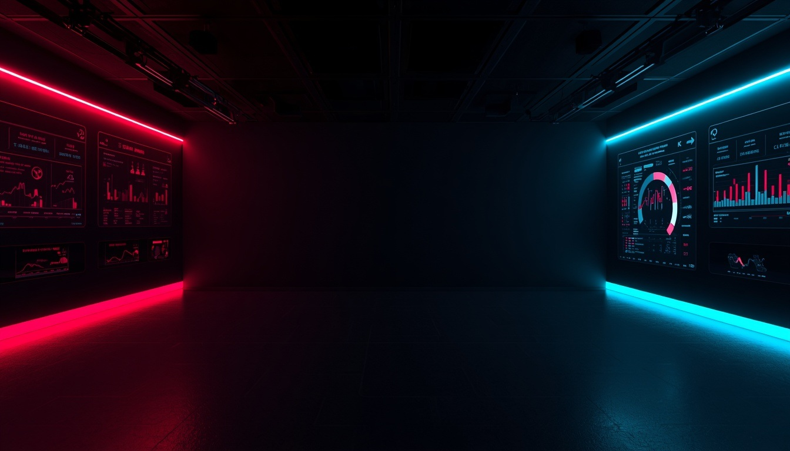

# Кіберспортивна академія «КіберЛьвів» (Cyber-Athletic HUD)

[](https://maksymivantsivpp2025.github.io/cyberlviv-academy/) [](https://cyberlviv-lab6.netlify.app/) [](https://cyberlviv-academy.vercel.app/)

Офіційний адаптивний лендинг кіберспортивної академії **«КіберЛьвів»** з інтегрованим калькулятором аналізу ігрового часу, розрахунком плану тренувань, оперативними інформерами арени та адаптивною формою зворотного зв'язку з клієнтською RegEx-валідацією і кастомним модальним вікном.

Проєкт розроблено в межах дисципліни **«Технології веброзробки та дизайну»** (Лабораторні роботи №1–9) у Національному університеті «Львівська політехніка» (Кафедра САП).



---

## Про проєкт та бізнес-задачу

Вебсайт вирішує проблему хаотичного ігрового режиму підлітків та молоді (12–19 років), перетворюючи аматорський геймінг у дисциплінах **CS2**, **Valorant** та **Dota 2** на структурований тренувальний процес із контролем здоров'я, постави, зору та режиму сну.

### Ключові можливості:
- **Cyber-Athletic HUD Дизайн-система:** темна кіберспортивна палітра (`#0a0a0c`, `#d91a52`, `#00f0ff`) із високим контрастом за стандартом доступності **WCAG 2.2 AA**.
- **Калькулятор ігрового часу та плану тренувань:** трикрокова модель балансу годин гри, сну, розминки Aim та розбору VOD-демок.
- **Мультимедійні інтеграції (Embedding):**
  - Нативне HTML5-відео (`<video>` WebM/MP4) у Hero-секції;
  - Адаптивний плеєр YouTube (`<iframe>` з `aspect-ratio: 16 / 9` та `loading="lazy"`);
  - Інтерактивна карта Google Maps локації буткемпу (м. Львів, вул. Івана Франка, 61).
- **Динамічний сайдбар інформерів (`<aside>`):**
  - Точний час у Львові (`Intl.DateTimeFormat`, часовий пояс `Europe/Kyiv`) та статус роботи арени;
  - Погода в реальному часі для Львова та Києва через **Open-Meteo API**;
  - Інтерактивний конвертер валют (`UAH / USD / EUR / PLN`) для розрахунку вартості навчання та турнірних призових.
- **Адаптивна форма зворотного зв'язку та клієнтська валідація (ЛР №9):**
  - Семантична верстка форми (`<form>`, `<label for>`, `<input>`, `<select>`, `<textarea>`, `<button>`) з підтримкою **WCAG 2.2 AA** (`aria-describedby`, `aria-invalid`, `role="alert"`);
  - 4 візуальні UI-стани кожного поля (`Normal`, `Focus`, `Error`, `Success`);
  - Перевірка регулярними виразами (`REGEX_EMAIL`, `REGEX_PHONE = /^\+380\d{9}$/`, `REGEX_NAME`) та UX-обробка граничних випадків (Edge Cases);
  - Кастомне доступне модальне вікно (`role="dialog"`, `aria-modal="true"`) з закриттям через кнопку, клік по оверлею та клавішу `Escape`.

---

## Стек технологій

- **Розмітка:** Семантичний HTML5 (`<header>`, `<nav>`, `<main>`, `<section>`, `<article>`, `<aside>`, `<form>`, `<footer>`)
- **Стилізація:** Tailwind CSS (Utility-First) + кастомні CSS3-змінні (`:root`) у `css/style.css`
- **Скрипти:** Нативний JavaScript (ES6+, RegEx, Fetch API, DOM API) у `assets/js/validation.js` та `js/widgets.js`
- **Іконки та типографіка:** Font Awesome 6, Google Fonts (`Orbitron`, `Inter`), оптимізована векторна графіка SVG
- **Контроль версій та CI/CD Деплой:** Git, GitHub, Vercel, GitHub Pages, Netlify

---

## Live Demo (Опубліковані версії сайту)

- **Vercel (CI/CD Production):** [https://cyberlviv-academy.vercel.app/](https://cyberlviv-academy.vercel.app/)
- **GitHub Pages:** [https://maksymivantsivpp2025.github.io/cyberlviv-academy/](https://maksymivantsivpp2025.github.io/cyberlviv-academy/)
- **Netlify Hosting:** [https://cyberlviv-lab6.netlify.app/](https://cyberlviv-lab6.netlify.app/)

---

## Структура репозиторію

```text
cyberlviv-academy/
├── assets/
│   ├── fonts/          # Локальні шрифти Inter та Orbitron (.woff2)
│   ├── icons/          # Векторний логотип та іконки переваг (.svg)
│   ├── images/         # Медіаактиви Hero-секції (.jpg, .mp4, .webm, .svg)
│   └── js/
│       └── validation.js # Модуль клієнтської RegEx-валідації форми та модального вікна (ЛР №9)
├── css/
│   └── style.css       # Кастомні змінні :root, стилі фреймів та анімації HUD
├── js/
│   ├── validation.js   # Дзеркальна копія модуля клієнтської валідації
│   └── widgets.js      # Асинхронний модуль погоди, точного часу та конвертера валют
├── .gitignore          # Правила ігнорування службових і тимчасових файлів
├── index.html          # Головна сторінка лендингу «КіберЛьвів»
└── README.md           # Документація проєкту
```

---

## Інструкція зі встановлення та локального запуску

1. **Клонувати репозиторій з GitHub:**
   ```bash
   git clone https://github.com/maksymivantsivpp2025/cyberlviv-academy.git
   ```
2. **Перейти в папку проєкту:**
   ```bash
   cd cyberlviv-academy
   ```
3. **Запустити проєкт локально:**
   - Відкрити папку в **Visual Studio Code**: `code .`
   - Запустити розширення **Live Server** (кнопка *Go Live* у нижній панелі VS Code) або відкрити файл `index.html` у будь-якому сучасному браузері.

---

## Автор та розробник

- **Виконав:** студент групи **ПП-24** Іванців Максим Богданович (`maksym.ivantsiv.pp.2025@lpnu.ua`)
- **Заклад вищої освіти:** Національний університет «Львівська політехніка», Інститут комп'ютерних наук та інформаційних технологій, Кафедра систем автоматизованого проєктування (САП)
- **Викладач:** Стефанович Тетяна Олександрівна
